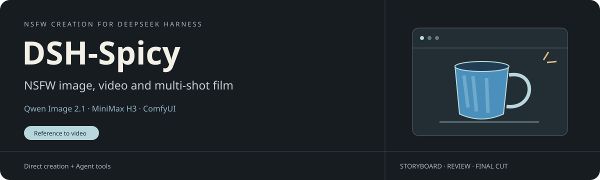

# Qwen Studio for DeepSeek Harness

Generate and edit images with Qwen Image 2.1, turn a reference into a MiniMax H3 shot with sound, or have your DSH agent storyboard, review and cut an entire film. The **创作** sidebar opens both image and video workspaces. [中文](README.md)

## Install the compiled plugin

Use DSH 0.2.2-rc.1 or later. Add the [native market index](https://kingcharleslzy-ai.github.io/dsh-qwen-studio/index.json) under Plugins → Discover → Index sources. Install `dsh-qwen-studio`. Alternatively, download the TGZ and checksum list from the [latest release](https://github.com/kingcharleslzy-ai/dsh-qwen-studio/releases/latest), verify the matching checksum, and run `dsh plugin --profile desktop add /absolute/path/to/dsh-qwen-studio.tgz` for that profile.

Upgrade the existing Qwen package in place. If a standalone H3 video or film bundle is selected, let active calls finish, disable those two bundles, then reload the combined plugin. Keep your data home, models, connection settings, project directory, character library and attachments. During transition the selected standalone bundles continue to own their tools. [Agent installation and migration](AGENTS.md)

## Choose a backend

| Task | Runtime | Setup |
| --- | --- | --- |
| Qwen images, native editing, LoRA and masks | Apple Silicon, Python 3.12, MFLUX and a full checkpoint | [Local image setup](docs/SETUP.md) |
| Self-hosted Qwen images | NVIDIA server or same-machine gateway, ComfyUI, direct connection or SSH | [GPU gateway](docs/REMOTE.md) |
| H3 clips with sound | Windows NVIDIA and ComfyUI on the DSH machine or over SSH | [Video weights, node check and connection](docs/H3-SETUP.md) |
| Multi-shot film with narration | POSIX editing host, FFmpeg, Python and writable project storage. The bundled speech backend uses macOS system voices. | [Film setup](docs/H3-SETUP.md) |

The plugin ships code and workflows. Obtain the models for your selected backend under their respective licenses.

## Work with the agent

- **“Paint a blue ceramic cup in watercolor.”** The image tool returns a gallery job and an image attachment. Use the attachment ID as the reference for a quality-mode video.
- **“Make that cup steam for five seconds, with room ambience.”** The H3 tool takes the ordered references and requested duration, then returns a job ID and playable MP4. Resume unfinished shots by ID.
- **“Make a one-minute pottery film with the same potter throughout.”** The agent creates character cards and a timed shot list, reviews real clips, revises rejected shots, renders the master and can record a final audiovisual review against the file hash.

Five skills register with DSH: [model setup](skills/studio-model-setup/SKILL.md), [creative routing](skills/studio-creation/SKILL.md), [image tools](skills/qwen-image/SKILL.md), [H3 single shots](skills/h3-video/SKILL.md), and [multi-shot filmmaking](skills/h3-long-film/SKILL.md). [Release history](CHANGELOG.md) · [Third-party notices](NOTICE).
