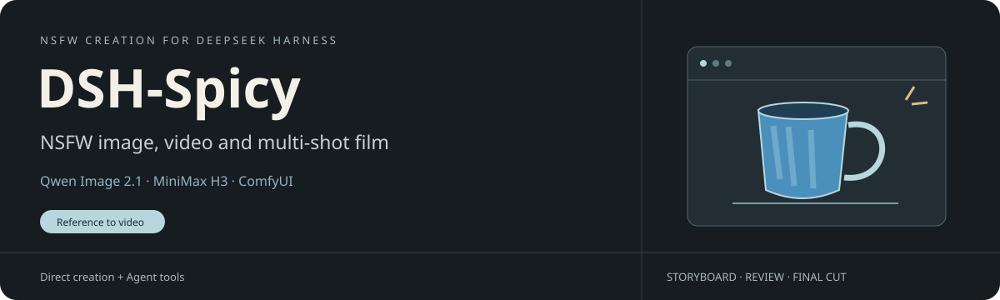
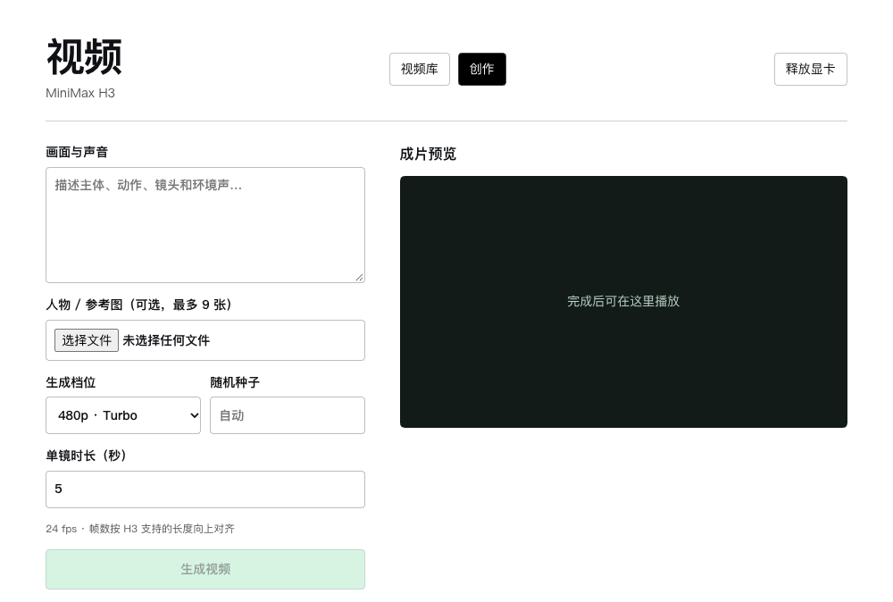

# DSH-Spicy

## 把这句话发给你的 DSH Agent

在已配置对话模型的 DeepSeek Harness 会话里，复制并发送下面整行：

```text
帮我装 DSH-Spicy，在本机生图和做视频。https://github.com/kingcharleslzy-ai/DSH-Spicy
```

在 Windows 11、RTX 4090 D 24 GB 的空白测试会话里，Agent 从这个链接找到教程、安装插件、下载七个权重，并通过 DSH 交付了 512×512 PNG 和 3.04 秒的有声 MP4。测试使用有足够空间的可写工作区，用户按 DSH 提示确认了安装和本机服务权限。基础双模型需要约 57 GB 权重，另需运行环境和缓存空间。[Windows 安装与验收](docs/WINDOWS-LOCAL.md)

<div align="center">



**完美适配 purge 的 nsfw content creation 插件**

在 DeepSeek Harness 中制作 **NSFW 成人向图像、有声视频和多镜头短片**。从成年虚构角色的一张定妆照开始，用 Qwen Image 2.1 调整造型、光线和构图，再交给 MiniMax H3 拍成有声镜头。创作可以在自己的机器或远程 GPU 上完成。

[](https://github.com/kingcharleslzy-ai/DSH-Spicy/releases/latest) [](https://github.com/kingcharleslzy-ai/DSH-Spicy/actions/workflows/ci.yml)

[下载插件](https://github.com/kingcharleslzy-ai/DSH-Spicy/releases/latest) · [Agent 安装手册](AGENTS.md) · [模型部署技能](skills/studio-model-setup/SKILL.md) · [English](README.en.md)

</div>

## NSFW 创作可以做什么

| 创作环节 | 在 DSH-Spicy 中怎么做 |
| --- | --- |
| 成人向写真与插画 | 用提示词生成成年虚构角色的定妆照，加载后端支持的 LoRA 统一画风，或用蒙版只重绘服饰、背景等选区。 |
| 从写真到动态镜头 | 将满意的作品作为 H3 质量档的参考图，描述镜头运动、人物动作与声音，生成可直接播放的 MP4。 |
| 多镜头叙事 | 让 Agent 用角色卡和参考图维持人物造型，按分镜生成片段。逐镜审看、重做，再加旁白、剪辑并导出母版。 |

## 安装

DSH **0.2.2-rc.1 或更新版本**。在「插件 → 发现 → 索引源」添加 [本项目市场索引](https://kingcharleslzy-ai.github.io/DSH-Spicy/index.json)，选择 **DSH-Spicy**（安装包 `dsh-qwen-studio`）。也可以从 Release 下载 [预编译 TGZ](https://github.com/kingcharleslzy-ai/DSH-Spicy/releases/latest/download/dsh-qwen-studio.tgz)，与 [SHA256SUMS.txt](https://github.com/kingcharleslzy-ai/DSH-Spicy/releases/latest/download/SHA256SUMS.txt) 中同名文件核对，再从实际 profile 安装。桌面版可用插件管理器，CLI 示例：

```sh
dsh plugin --profile desktop add /absolute/path/to/dsh-qwen-studio.tgz
```

**从 3.0.1 或更早版本升级**：在上面的新市场索引安装一次，或使用 Release 的 TGZ 原位升级。旧版内置更新器校验旧仓库地址；从 3.0.2 起会检查新仓库。已有独立视频或长片插件时，等任务结束，停用旧的 `dsh-h3-video`、`dsh-h3-film-local` 两个 bundle，再重新加载创作插件。图库、预设、视频、角色卡和未完成工程沿用原位置。兼容过渡与回退见 [迁移说明](AGENTS.md#旧插件迁移与回退)。

## 打开左栏「创作」，或直接在对话里说

| 要做什么 | 可以这样说 | 交付结果 |
| --- | --- | --- |
| 画图、局部重绘或参考编辑 | 把这只蓝色陶杯改成水彩，保留把手和构图。 | 图像附件、图库记录、任务 ID |
| 拍一个单镜 | 用刚画的杯子做参考，拍 5 秒热气升起的镜头，保留环境声。 | H3 质量档 MP4、对话播放器 |
| 制作完整影片 | 做一支 60 秒的陶艺短片，人物跨镜一致，配中文旁白。 | 角色卡、分镜工程、逐镜审片、剪辑母版 |

图像页支持 LoRA、ControlNet、蒙版、预设、检索和批量任务；视频页支持 480p / 768p、Turbo / 质量档、1–9 张参考图、收藏、归档和本地播放。参考图用质量档，单镜可请求 1–15 秒。长片由对话 Agent 推进，先审代表镜，完成的母版会进入视频库。



首次在 Windows NVIDIA 电脑同时部署图像和视频，可从 [Windows 双模型部署与验收](docs/WINDOWS-LOCAL.md) 开始。视频默认进入创作页，[高级设置](docs/VIDEO.md#视频创作的高级设置)可指定画幅、种子和质量档步数。

## 按设备选择模型

| 运行位置 | 配置内容 | 从这里开始 |
| --- | --- | --- |
| Apple Silicon Mac 本机 | MFLUX、完整 Qwen checkpoint | [本机图像部署](docs/SETUP.md) |
| 本机或远程 NVIDIA | Qwen ComfyUI、专用网关、按需 SSH | [图像服务器部署](docs/REMOTE.md) |
| Windows NVIDIA，本机或 SSH | MiniMax H3、对应权重、ComfyUI、工作流核对 | [视频模型部署](docs/H3-SETUP.md) |
| macOS 剪辑端 + Windows GPU | FFmpeg、工程目录、系统旁白、角色库 | [长片剪辑与旁白](docs/H3-SETUP.md#长片剪辑与旁白) |

插件随包提供工作流、桥接和技能。权重、算力、连接和作品由安装者自行管理。可以只配置要用的功能。

## 给安装插件的 Agent

> 请先读仓库根目录 AGENTS.md，检查我当前的 DSH profile 和已有模型。按 studio-model-setup 配置我选择的后端，告诉我哪些检查已通过，再用我指定的素材完成一次创作。

| 自动注册的技能 | 何时使用 |
| --- | --- |
| [studio-model-setup](skills/studio-model-setup/SKILL.md) | 安装、升级、模型与连接诊断 |
| [studio-creation](skills/studio-creation/SKILL.md) | 选择创作流程，将 Qwen 附件交给 H3 |
| [qwen-image](skills/qwen-image/SKILL.md) | 图像、编辑、资源、预设、批量与任务恢复 |
| [h3-video](skills/h3-video/SKILL.md) | 单镜生成、查询与取片 |
| [h3-long-film](skills/h3-long-film/SKILL.md) | 角色、分镜、重做、旁白、审片和交付 |

## 实际图像示例

| 参考照片 | Qwen 原生参考编辑 |
| --- | --- |
|  |  |

示例来自此前 Qwen 图像版的本机 MLX 实测。原图与编辑图的署名和 CC BY-SA 条款见 [素材说明](docs/media/CREDITS.md)。[图像操作与参数](docs/SETUP.md) · [单镜与视频库](docs/VIDEO.md) · [历史验证记录](docs/VERIFICATION.md) · [更新记录](CHANGELOG.md)。

开发环境使用 Node 22.19+ 或 24+、Python 3.12。执行 `npm ci --ignore-scripts`、`npm run check`、`npm run check:privacy`、`npm run check:package`。第三方组件归属见 [NOTICE](NOTICE)，模型许可见各模型卡。
