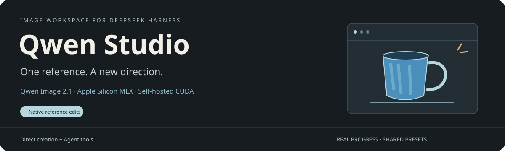
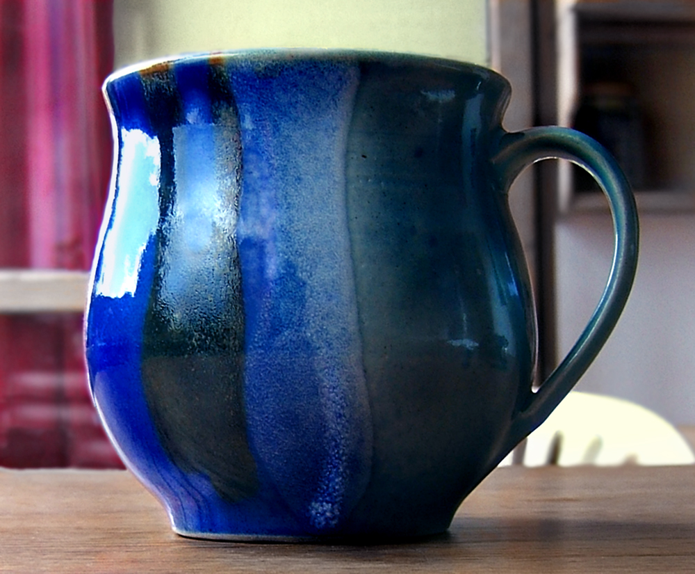
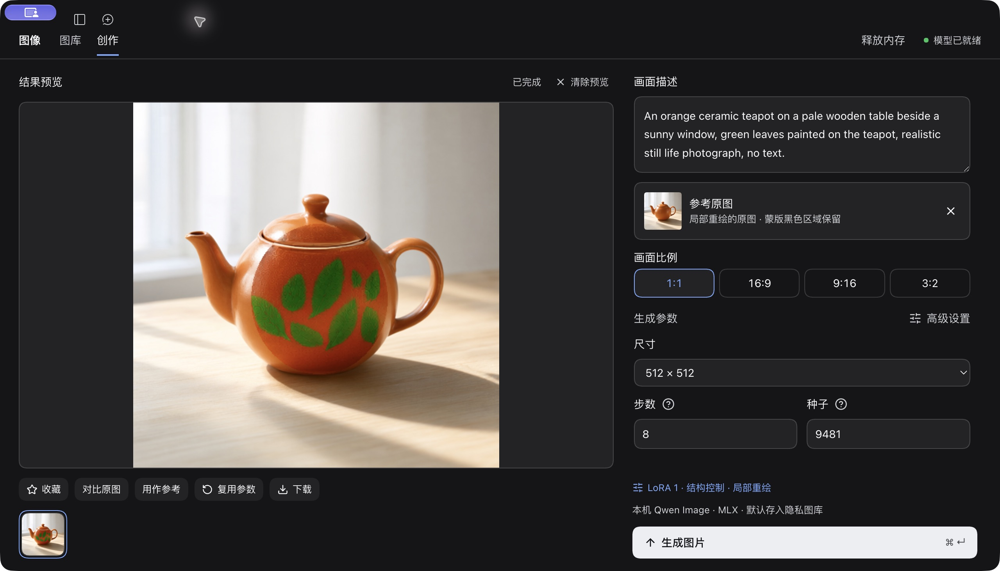
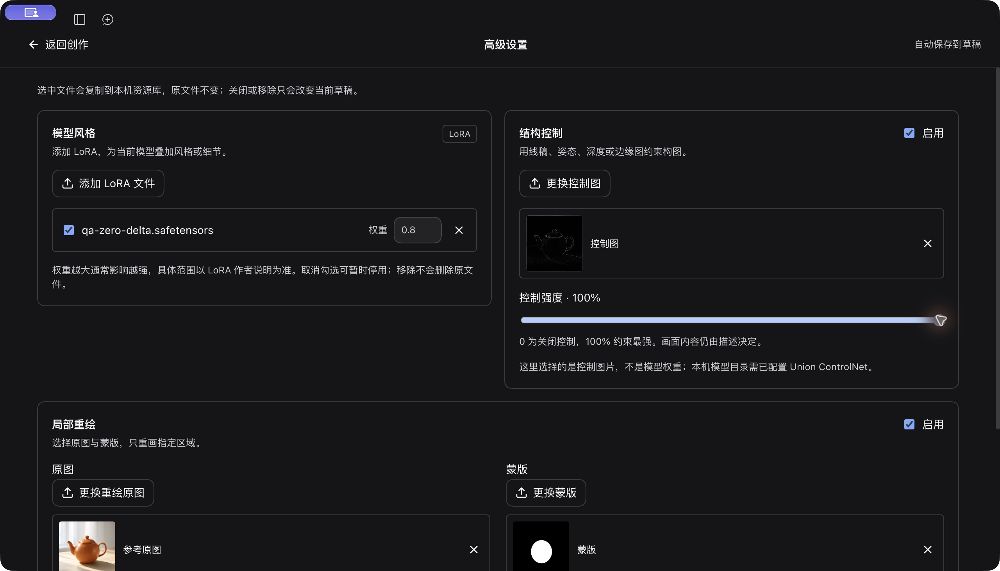
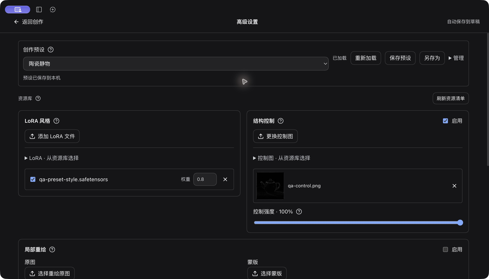

<div align="center">



# 图像 · Qwen Studio

**在 DSH 里生成、改图、继续创作。Apple Silicon 本机 MLX，或你自己的 NVIDIA GPU。**

Native Qwen Image 2.1 generation & reference editing for **DeepSeek Harness**.

[](https://github.com/kingcharleslzy-ai/dsh-qwen-studio/releases/latest)
[](https://github.com/kingcharleslzy-ai/dsh-qwen-studio/actions/workflows/ci.yml)
[](docs/SETUP.md)
[](docs/REMOTE.md)
[](LICENSE)

[**下载安装**](#三步开始) · [**English**](README.en.md) · [本机部署](docs/SETUP.md) · [远程 GPU](docs/REMOTE.md) · [实测记录](docs/VERIFICATION.md)

</div>

## 给一张参考，换一种画法

<table>
<tr><th width="50%">参考照片</th><th width="50%">本机 MLX 原生编辑</th></tr>
<tr><td align="center"></td><td align="center"></td></tr>
</table>

> 「把这只蓝杯转成水彩，保留杯形和构图，呈现纸张纹理与透明笔触。」

**真实插件输出，无后期修图。** Qwen Image 2.1 / MFLUX 0.22.0 / 512×512 / 20 步。原图：Wildfeuer，[Wikimedia Commons](https://commons.wikimedia.org/wiki/File:2008-05-01Blaue_Tasse01.jpg)，示例按 CC BY-SA 3.0 分享；[图像署名与授权](docs/media/CREDITS.md)。这是一次功能实测，不代表所有编辑指令的成功率。

## 一个工作区，两种创作方式

**直接创作**：打开 DSH 左侧「图像」，写描述、选参考、调参数。无需文字模型代为调用。

**让 Agent 创作**：在会话里说「找一张参考图，把它改成水彩」。内置技能指导模型搜索、导入，再使用插件工具；对话和创作页显示同一任务的进度与图片。



- **按图改画风** — 本机 MLX 与配套远程网关均支持原生参考编辑。参考图片和指令共同参与生成，按完整步数采样。
- **把高级功能点出来** — LoRA、ControlNet、蒙版、负向词、CFG、调度器均在高级设置中配置；本机文件选择器和资源清单可反复选用。
- **调好一次，保存一套** — 命名预设、默认项、参数复用、JSON 导入导出；Agent 与面板使用同一个预设库。
- **切页继续，进度跟随** — 持久任务队列，真实采样步数；完成图在对话、创作页和图库同步。查询已有结果不会重新生图。
- **用时启动，空闲释放** — 本机模型按需加载；远程按需 SSH、资源自动同步，模型卸载后断开。统一空闲时间可由界面或 Agent 调整。
- **试稿收好，作品精选** — 默认存入隐私图库，收藏后进入普通图库；支持搜索、批量归档与回收站。隐私分类不隐藏对话图片，也不是加密或密码锁。

这是 **DeepSeek Harness 插件**，不是独立生图 App。应用里叫「图像」，安装包为 `dsh-qwen-studio`，当前 **2.11.0**。独立维护、独立发布，无需安装旧 `dsh-image-gen`。

## 三步开始

**1. 安装插件。** 从 [Releases](https://github.com/kingcharleslzy-ai/dsh-qwen-studio/releases/latest) 下载 `.tgz`，运行：

```sh
dsh plugin --profile desktop add /absolute/path/dsh-qwen-studio-2.11.0.tgz
```

macOS 未安装全局 `dsh` 时，可使用桌面版内置 CLI：

```sh
sh "/Applications/DeepSeek Harness.app/Contents/Resources/runtime/cli/bin/dsh" \
  plugin --profile desktop add /absolute/path/dsh-qwen-studio-2.11.0.tgz
```

**2. 选择推理位置。** 正常退出并重新打开 DSH，在插件设置中配置「图像」：

| 本机 Apple Silicon Mac | 自己的 NVIDIA GPU |
| --- | --- |
| Python 3.12 + MFLUX 0.22.0 | 配套 CUDA / ComfyUI Qwen 网关 |
| 准备完整 Qwen Image 2.1 权重 | 准备服务器模型与访问地址 |
| 选择 Python 环境、模型和图库目录 | 填写 `/v1` 地址、模型名、可选密钥与 SSH 别名 |
| [本机安装步骤 →](docs/SETUP.md) | [远程部署步骤 →](docs/REMOTE.md) |

模型权重独立准备，不随插件分发，也不会在首次打开时自动下载几十 GB 文件。原生编辑需要含视觉编码器与 `processor` 的完整模型；纯文本导出不通用。已有用户原位升级，沿用当前数据目录与预设。

**3. 开始创作。** 左侧「图像 → 创作」输入描述；或在会话中说：

> 画一张清晨山间小屋的横版插画。
>
> 上网找一张陶瓷杯参考图，用图像插件改成水彩。
>
> 用我现有的 LoRA 和控制图保存一套预设，先不要生成。
>
> 把刚才那张图再显示一次，不要重新生成。

## 两种参考模式，明确选择

| 模式 | 适合什么 | 参数 |
| --- | --- | --- |
| **参考变体** | 保留原图、做轻微变化 | `source_image_id` + `change_strength`；旧预设默认行为 |
| **原生参考编辑** | 按指令换画风、改颜色、编辑主体 | `source_image_id` + `reference_mode="edit"`；完整采样 |

创作页选择参考图后，在高级设置中选「参考图用法」。Agent 先查询当前后端 `reference_edit.supported`，再选择模式。组件缺失会明确提示，不会静默删参数或切换到另一台机器。

原生编辑目前使用 `linear` 和 32 倍数尺寸，不与控制图、蒙版混用；同一 LoRA 通道可用，具体适配器的编辑效果需实测。本机启用前缀 KV 复用，**不启用跳步缓存、Turbo 或隐式重试**。前缀缓存会记录在结果中；固定种子也不保证跨后端像素一致。

## 功能与后端

| 功能 | Apple Silicon · MLX | 配套远程 · CUDA | 普通 Images API |
| --- | :---: | :---: | :---: |
| 文生图 | ✓ | ✓ | ✓ |
| 参考变体 / 原生编辑 | ✓ / ✓¹ | ✓ / ✓¹ | — |
| LoRA 叠加 | ✓ | ✓ | — |
| ControlNet / 蒙版重绘 | ✓² | ✓² | — |
| 真实采样步数 | ✓ | ✓ | 仅处理状态 |
| 持久任务、图库、预设 | ✓ | ✓ | ✓，以基础参数为限 |
| Agent 自动导入参考图 | ✓ | ✓ | 可导入，但该服务不支持参考生成 |

¹ 需要兼容的 MFLUX / 网关及完整视觉模型。插件当前一次使用一张参考图，不代表已开放 MFLUX 的全部多图能力。

² 需要对应的 Qwen Image 2.1 Union 权重；黑色蒙版区域从输出尺寸下的原图复制，白色区域重画。插件不自动提取人体姿态或绘制蒙版。

<details>
<summary><b>看高级设置和整套预设</b></summary>





</details>

## Agent 也能配置，不只是按下生成

启用插件自动注册 `qwen-image` 技能，无需复制技能目录。简介、触发条件与执行步骤来自[同一份技能说明](skills/qwen-image/SKILL.md)。

| 工具 | 用途 |
| --- | --- |
| `qwen_image_import` | 图片直链、本机文件、真实会话附件 → 资源 ID；不启动推理 |
| `qwen_image_resources` | 查询 LoRA、图片输入与当前原生编辑能力 |
| `qwen_image_presets` | 保存、加载、重命名、默认、导入导出整套参数 |
| `qwen_generate_image` | 提交同一持久队列，返回图片附件和任务 ID |
| `qwen_image_status` | 查进度、取回原结果，不重新生成 |
| `qwen_image_connection` | 实时切本机/远程、修改统一空闲时间 |

只配置不生图，只写提示词不生图；已提交任务超时先查状态，不自动重提或绕去执行独立脚本。找图使用当前会话已有搜索/浏览器工具，插件不自带搜索引擎。

导入支持 PNG/JPEG/WebP；公开直链需能直接取得图片，HTML 页面需先提取图片 URL。逐跳校验公网地址、限制大小和耗时；Fake-IP 兼容仅限本插件请求，不修改系统代理或 DNS。远程资源按 SHA256 同步，预设里的本机文件名不会被误当成服务器路径。

## 已验证，也有边界

[实测记录](docs/VERIFICATION.md) 区分自动检查、插件执行体联调和原生 DSH 验收，保留具体版本与限制。2.11.0 通过 **65 项工具/界面测试 + 31 项后端测试**。原生 DSH 本机实测40/40步完成蓝杯转水彩，对话与创作页同步，355个既有设置/预设/图库文件校验未变。当前测试覆盖 Apple Silicon / MFLUX 与 Windows / RTX 4090 D；Linux 远程尚未完成真实 GPU 验收，CI 不运行模型推理。

自然语言触发已在 DSH / DeepSeek-V41-Flash 验证；其他模型取决于工具能力、上下文与 DSH 权限。原生编辑不保证每条指令成功，通路可用也不等于任意第三方 LoRA 都有好效果。

图库与预设保存在自己选择的数据目录，升级不迁移或清空原件。导出预设只包含参数和资源指纹，不含模型、图像文件、连接密钥或设备绝对路径；缺失资源加载时明确提示。[安装与数据说明 →](docs/SETUP.md)

## 开发与反馈

```sh
git clone https://github.com/kingcharleslzy-ai/dsh-qwen-studio.git
cd dsh-qwen-studio
npm ci
npm run check
npm run check:package
```

开发需要 Node.js `^22.19.0 || >=24`、Python 3.12、Pillow 11–12。接口与界面在 `src/`，worker 与网关在 `backend/`。发布包含编译包、技能及 SHA-256，不包含权重、图库或个人日志。

[报告 Bug / 提建议](https://github.com/kingcharleslzy-ai/dsh-qwen-studio/issues) · [更新记录](CHANGELOG.md) · [English guide](README.en.md)

源于 [shanliuling/dsh-image-gen](https://github.com/shanliuling/dsh-image-gen) 的 DSH 生图集成，现独立维护，保留原始署名；代码按 [Apache-2.0](LICENSE) 发布，见 [NOTICE](NOTICE)。[示例图像许可](docs/media/CREDITS.md)单列。Qwen 权重、MFLUX / MLX 与 ComfyUI 遵循各自许可证。本项目非 Qwen、MFLUX 或 DeepSeek 官方插件。
